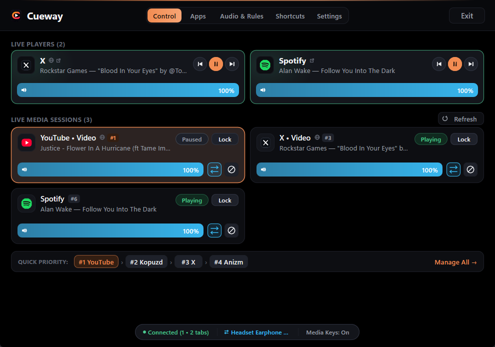
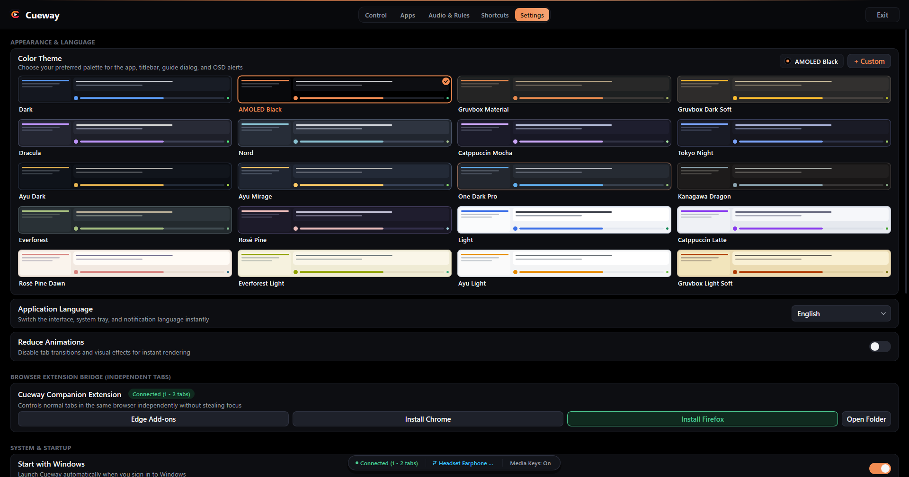

<div align="center">


# Cueway

Lightweight native media & audio controller for Windows — priority media key routing, per-tab volume control, and instant tray controls.

<p>
  <a href="https://github.com/mr-glemsi/Cueway/releases/latest">
    
  </a>
  <a href="https://microsoftedge.microsoft.com/addons/detail/cueway-companion/cebckhofejojabmcfeinkdclglibafmk">
    
  </a>
  
  <a href="LICENSE">
    
  </a>
</p>

<br />



</div>

Cueway routes hardware media keys to the highest-priority active player on your system. It works with desktop applications (including players without native Windows media session support) and individual browser tabs through a local companion extension.

## Download

Download the latest Windows installer (`Cueway-Setup-x64.exe`) from the [Releases](https://github.com/mr-glemsi/Cueway/releases/latest) page.

## Features

**Media Routing & Browser Control**
- Priority-based routing for hardware media keys across desktop apps and individual browser tabs (Chrome, Edge, Brave, Opera, Firefox, Zen)
- Automatic detection of desktop audio sources (with or without Windows SMTC) and embedded iframe web players
- Manual target lock, solo mode, and fullscreen game guard

**Tray & Smart Audio**
- Compact tray quick-control flyout with per-session playback controls, volume sliders, and an instant audio output switcher (headphones ↔ speakers)
- Per-site volume memory for browser tabs so noisy websites stay at your preferred level
- Smart audio ducking for new media and active voice calls / microphone sessions, plus a 10-second fade-out sleep timer

**Native & Customizable**
- Fast Native AOT Windows build with low idle footprint and an in-app auto-updater
- Optional global hotkeys (playback, target volume, mute, output device cycle, per-app priority) and a one-click ignore list
- Custom Theme Studio and 13 interface languages

## Interface & Customization

### Application Priority & Ignore List

<div align="center">
  
</div>

### Themes & Appearance

<div align="center">
  
</div>

### System & Extension Settings

<div align="center">
  
</div>

## Browser Extensions

The companion extensions talk to the desktop app over a local loopback WebSocket (`127.0.0.1:47621`) and make no external network requests.

- **Microsoft Edge:** [Cueway Companion on Edge Add-ons](https://microsoftedge.microsoft.com/addons/detail/cueway-companion/cebckhofejojabmcfeinkdclglibafmk)
- **Chromium (Chrome, Brave, Opera):** `BrowserExtension/Chromium` (Manifest V3)
- **Firefox:** `BrowserExtension/Firefox` (Manifest V2)

## Building from Source

Requires the .NET 10 SDK (with the C++ desktop workload for Native AOT). Inno Setup 7 is optional for packaging the installer.

```powershell
# Debug build
dotnet build Cueway.csproj -c Debug

# Release build (Native AOT)
dotnet publish Cueway.csproj -c Release -r win-x64

# Installer (optional)
& "C:\Program Files\Inno Setup 7\ISCC.exe" Cueway.iss
