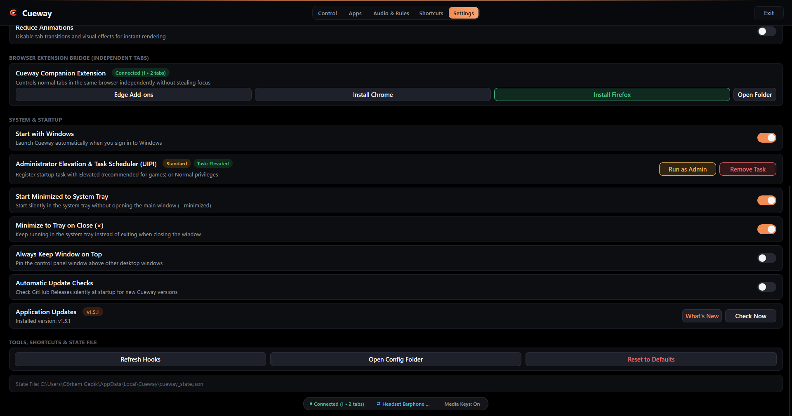

<div align="center">


# Cueway

Lightweight media key router and per-tab media controller for Windows 10 and 11.

<p>
  <a href="https://github.com/mr-glemsi/Cueway/releases/latest">
    
  </a>
  <a href="https://microsoftedge.microsoft.com/addons/detail/cueway-companion/cebckhofejojabmcfeinkdclglibafmk">
    
  </a>
  
  <a href="LICENSE">
    
  </a>
</p>

<br />


</div>

Cueway routes hardware media keys to the highest-priority active player on your system. It works with desktop applications (including players without native Windows media session support) and individual browser tabs through a local companion extension.

## Download

Download the latest Windows installer (`Cueway-Setup-x64.exe`) from the [Releases](https://github.com/mr-glemsi/Cueway/releases/latest) page.

## Features

- Priority-based routing for hardware media keys and playback controls
- Per-tab playback, volume, mute, and focus control through the companion browser extension
- EarTrumpet-style tray quick control flyout on left-click with a built-in audio output switcher (headphones ↔ speakers) and optional cycle shortcut
- Per-site volume memory for browser tabs (enabled by default, with one-click clear)
- Automatic detection of active desktop audio sources, with or without Windows SMTC support
- Smart audio ducking for new media and voice call / microphone activity
- 10-second fade-out sleep timer from the tray flyout and context menu
- Optional global target volume hotkeys (`Volume Up`, `Volume Down`, `Mute`) for the active player or tab
- Manual target lock (`Alt+M`), solo mode (`Alt+S`), and one-click ignore list for unwanted apps or sites
- Fullscreen game detection and automatic pause/resume for lower-priority players
- Lightweight native Windows build with 13 interface languages, custom themes, and a system tray interface

## Settings & Customization

<div align="center">
  
</div>

## Browser Extensions

The companion extensions talk to the desktop app over a local loopback WebSocket (`127.0.0.1:47621`) and make no external network requests.

- **Microsoft Edge:** [Cueway Companion on Edge Add-ons](https://microsoftedge.microsoft.com/addons/detail/cueway-companion/cebckhofejojabmcfeinkdclglibafmk)
- **Chromium (Chrome, Brave, Opera):** `BrowserExtension/Chromium` (Manifest V3)
- **Firefox:** `BrowserExtension/Firefox` (Manifest V2)

## Building from Source

Requires the .NET 10 SDK (with the C++ desktop workload for Native AOT). Inno Setup 7 is optional for packaging the installer.

```powershell
# Debug build
dotnet build Cueway.csproj -c Debug

# Release build (Native AOT)
dotnet publish Cueway.csproj -c Release -r win-x64

# Installer (optional)
& "C:\Program Files\Inno Setup 7\ISCC.exe" Cueway.iss
```

## Privacy

Cueway runs entirely locally and does not collect or send user data. See [PRIVACY.md](PRIVACY.md) for details.

## License

[MIT](LICENSE)
