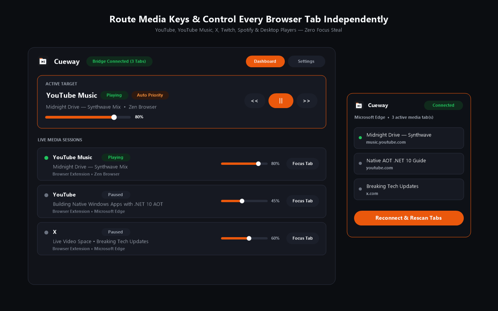

# Cueway

**Lightweight, Native AOT (.NET 10) Windows 10/11 Media Key Router & Tab Controller**



Cueway routes your hardware media keys (`Play/Pause`, `Next`, `Previous`, `Stop`) and timeline scrubbing directly to the highest-priority player on your PC—even across **individual tabs inside the same browser** (YouTube, YouTube Music, X, Twitch, Kick) and apps without SMTC (Stremio, VLC, Discord, mpv).

---

## Key Features

- **Native AOT & Ultra-Light:** Single ~5.5 MB executable, ~14 MB RAM, zero third-party packages, zero idle disk reads, and custom hardware-accelerated Win32/GDI+ UI.
- **Per-Tab Browser Control (`Cueway Companion`):** Control, mute, adjust real player volume, and focus individual browser tabs over a local-only WebSocket bridge (`ws://127.0.0.1:47621`) without stealing window focus.
- **Universal App Recognition:** Combines Windows SMTC, mpv IPC pipes, and CoreAudio WASAPI peak detection (Stremio, VLC, PotPlayer, Discord, etc.) with zero hardcoded app lists.
- **Priority Queue & Manual Lock (`Alt+M`):** Automatically follows your custom app ranking or locks onto a specific app/tab.
- **Solo Mode (`Alt+S`):** Mutes background audio sources except the active target.
- **Fullscreen Game Guard & Auto-Pause/Resume:** Keeps games uninterrupted and automatically pauses secondary players when a higher-priority app starts.
- **9 Languages & 8 Themes:** Turkish, English, Chinese, Spanish, Russian, German, French, Japanese, and Korean; Dark, Light, Nord, Emerald, Amethyst, Amber, Crimson, and Warm Sand themes.

---

## Companion Browser Extensions

- **Firefox / Zen Browser:** `BrowserExtension/Firefox` (MV2)
- **Microsoft Edge / Google Chrome / Brave / Opera:** `BrowserExtension/Chromium` (MV3)

Ready-to-submit store archives and instructions are in [`StoreSubmission/`](StoreSubmission/SUBMISSION-GUIDE.md).

---

## Build from Source

Requires **.NET 10 SDK** (with Native AOT Desktop C++ workload) and optional **Inno Setup 7** for the installer:

```powershell
# Debug build
dotnet build Cueway.csproj -c Debug

# Native AOT single-file Release executable
dotnet publish Cueway.csproj -c Release -r win-x64

# Optional Windows installer
& "C:\Program Files\Inno Setup 7\ISCC.exe" Cueway.iss
```

---

## Privacy & License

- **100% Local, Zero Telemetry:** See [`PRIVACY.md`](PRIVACY.md).
- **License:** [MIT](LICENSE)
